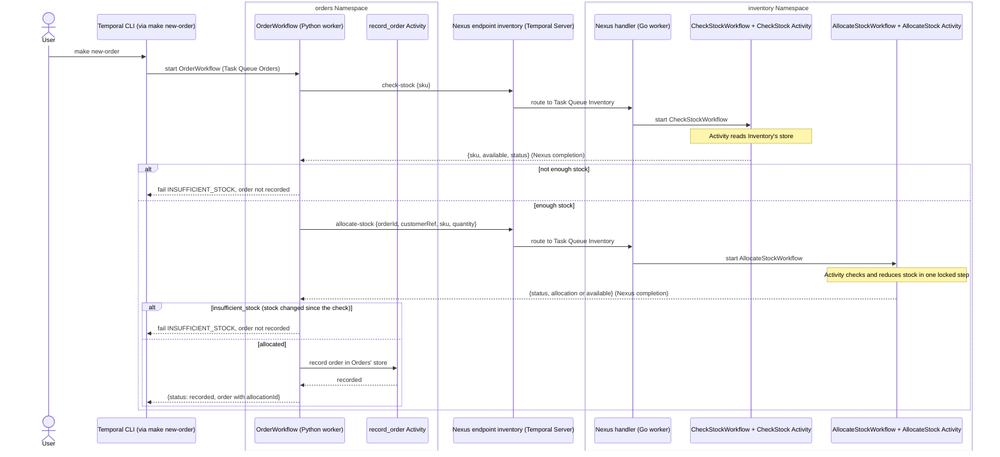

# temporal-nexus-example

A Temporal Nexus reference architecture: a workshop demo where a Python
**Orders** service calls a Go **Inventory** service through Temporal Nexus.
Shipping is not implemented.

<!-- toc -->

* [Run the demo](#run-the-demo)
  * [Prerequisites](#prerequisites)
  * [Walkthrough](#walkthrough)
  * [Order IDs and idempotency](#order-ids-and-idempotency)
  * [Things to know](#things-to-know)
  * [How it works](#how-it-works)
* [Inventory service](#inventory-service)
  * [Start the worker](#start-the-worker)
  * [Workflows](#workflows)
  * [Seeded stock](#seeded-stock)
  * [Limitations](#limitations)
* [Orders service](#orders-service)
  * [Install](#install)
  * [Configure and start the worker](#configure-and-start-the-worker)
  * [Live reload (Compose)](#live-reload-compose)
  * [Run OrderWorkflow](#run-orderworkflow)
  * [Order storage limitations](#order-storage-limitations)
* [Nexus: inventory operations](#nexus-inventory-operations)
* [Contributing](#contributing)
  * [Open in a container](#open-in-a-container)
  * [Commit style](#commit-style)

<!-- Regenerate with "pre-commit run -a markdown-toc" -->

<!-- tocstop -->

## Run the demo

### Prerequisites

* Docker with Docker Compose. `compose.yml` uses `pre_start` and `post_start`
  hooks; it validates with Compose v5.7.0.
* `make` and `bash`. The Make targets use bash's `$RANDOM`.
* The [Temporal CLI](https://docs.temporal.io/cli), on your machine or in the
  dev container, not inside Compose. It connects to the default
  `localhost:7233`, which Compose publishes. The dev container includes it;
  this walkthrough used CLI 1.10.0.

### Walkthrough

1. **Start the stack.** This starts the Temporal dev server, the Go Inventory
   worker and the Python Orders worker. It also creates the `orders` and
   `inventory` Namespaces and the `inventory` Nexus endpoint.

   ```sh
   docker compose up -d --build
   docker compose ps   # wait until temporal and inventory are healthy
   ```

2. **Open Temporal UI** at <http://localhost:8233>. Use the Namespace switcher
   to move between `orders` and `inventory`.

3. **Check stock.** This runs `CheckStockWorkflow` for `WIDGET-1` directly in
   the `inventory` Namespace:

   ```sh
   make check-stock
   # Result {"available":10,"sku":"WIDGET-1","status":"found"}
   ```

4. **Create an order.** This starts `OrderWorkflow` in the `orders` Namespace
   for 2 × `WIDGET-1`, with order ID `order-<random number>`:

   ```sh
   make new-order
   # Result {"message":"","order":{...,"allocationId":"ALLOC-order-12345",
   #   "inventoryAllocated":true,"inventoryChecked":true,...},"status":"recorded"}
   ```

5. **Check stock again** with `make check-stock`. `available` is now 8.

6. **Exhaust the stock.** Starting from fresh stock, five orders use all 10
   units. The sixth `make new-order` fails with a non-retryable
   `INSUFFICIENT_STOCK` error, and the order is not recorded. The failure
   carries:

   * Message: `Insufficient stock for WIDGET-1: requested 2, available 0`
   * Details: `{"sku":"WIDGET-1","requestedQuantity":2,"availableQuantity":0}`

   Here the initial stock check catches it, so `allocate-stock` is never
   called. To see the error type and details, open the failed run in the UI
   (`orders` Namespace) or run
   `temporal workflow show --namespace orders -w <order-id> -o json`. In the
   JSON output the details payload is base64-encoded.

7. **Inspect the executions.**
   * `orders` Namespace: each `OrderWorkflow` run (Workflow ID `order-…`). Its
     history shows `NexusOperationScheduled`, `Started` and `Completed` for
     `check-stock`, then `allocate-stock`, then the `record_order` Activity.
   * `inventory` Namespace: the Workflows that Nexus started, named
     `check-stock-<request-id>` (`CheckStockWorkflow`) and
     `allocate-stock-<request-id>` (`AllocateStockWorkflow`). Runs started by
     `make check-stock` have CLI-generated IDs.

   ```sh
   temporal workflow list --namespace orders
   temporal workflow list --namespace inventory
   ```

8. **Stop the stack** with `docker compose down`. Temporal history is kept in
   the `temporal_data` volume; `docker compose down -v` also deletes it.

### Order IDs and idempotency

Every order needs a unique order ID. Inventory uses it as the allocation
idempotency key: repeating an order ID returns the existing allocation and does
**not** reduce stock again.

`make new-order` generates `order-$RANDOM`, a number from 0 to 32767. This is
**not guaranteed to be unique**. If an ID repeats, the order looks successful
but stock does not drop. Check the order ID in the output if the numbers look
wrong.

### Things to know

* Orders is Python (`services/orders`); Inventory is Go (`services/inventory`).
  Each runs in its own Namespace and only talks to the other through the Nexus
  endpoint.
* Inventory starts with seeded in-memory stock (see
  [Seeded stock](#seeded-stock)). The walkthrough numbers assume fresh stock.
* Restarting Inventory resets its stock and allocations. Restarting Orders
  resets its in-memory order records.
* Both workers reload on source changes during development (Air for Go,
  watchfiles for Python). A reload restarts the worker, so it resets that
  worker's in-memory state too.
* Temporal history persists in the `temporal_data` volume, so old executions
  stay visible after the workers' state resets.
* Shipping is not implemented.

### How it works

The Nexus endpoint is a routing destination on the Temporal Server. It
delivers Operations to the Inventory worker's Task Queue. Orders never calls
the Go worker directly, and each service owns its own in-memory store.



## Inventory service

A Go worker on the `Inventory` Task Queue. It exposes stock checking and
allocation through Nexus (see
[Nexus: inventory operations](#nexus-inventory-operations)).

### Start the worker

Start a local Temporal server (for example, `temporal server start-dev`), then:

```sh
cd services/inventory
go run ./cmd/worker
```

The worker connects using the `TEMPORAL_ADDRESS` and `TEMPORAL_NAMESPACE`
environment variables. The defaults are `localhost:7233` and `default`.

### Workflows

The examples use the `inventory` Namespace from Compose.

`CheckStockWorkflow` reports available stock. It does not change stock.

```sh
temporal workflow execute --namespace inventory --task-queue Inventory \
  --type CheckStockWorkflow \
  --workflow-id check-widget --input '{"sku":"WIDGET-1"}'
# {"sku":"WIDGET-1","available":10,"status":"found"}
```

`AllocateStockWorkflow` checks stock and allocates it in one locked step:

```sh
temporal workflow execute --namespace inventory --task-queue Inventory \
  --type AllocateStockWorkflow \
  --workflow-id allocate-order-1 \
  --input '{"orderId":"order-1","customerRef":"cust-1","sku":"WIDGET-1","quantity":4}'
# {"status":"allocated","allocation":{"allocationId":"ALLOC-order-1",...}}
```

Business outcomes appear in `status`. The Workflow still completes:

* `CheckStockWorkflow`: `found` or `unknown_product`.
* `AllocateStockWorkflow`: `allocated`, `unknown_product`, `invalid_quantity`,
  `insufficient_stock` or `conflict`.

The order ID is the idempotency key. Repeating an identical request returns the
existing allocation without using more stock. Reusing the same order ID with
different details returns `conflict`.

### Seeded stock

| SKU | Quantity |
| --- | --- |
| `WIDGET-1` | 10 |
| `GADGET-1` | 3 |
| `GIZMO-1` | 0 |

### Limitations

Stock and allocation records are stored in the worker's memory.

* Run exactly **one** Inventory worker process. Multiple workers would each have
  separate stock.
* Restarting the worker resets stock to the seeded values and loses all
  allocation records, including idempotency records.

## Orders service

A Python worker on the `Orders` Task Queue. Requires Python 3.10+.

### Install

```sh
cd services/orders
python3 -m venv .venv
.venv/bin/pip install -e .
```

### Configure and start the worker

Connection settings come from environment variables only. File-based
configuration (`temporal.toml`) is disabled.

| Variable | Default |
| --- | --- |
| `TEMPORAL_ADDRESS` | `localhost:7233` |
| `TEMPORAL_NAMESPACE` | `default` |
| `TEMPORAL_API_KEY` | unset (only needed for Temporal Cloud) |

Other `TEMPORAL_*` variables are listed in the
[environment configuration docs](https://docs.temporal.io/develop/environment-configuration).

```sh
.venv/bin/orders-worker
```

### Live reload (Compose)

Compose builds the Orders `dev` image stage. It installs the package in editable
mode and runs the worker under
[watchfiles](https://watchfiles.helpmanual.io/cli/), the Python equivalent of
Air.

* Editing a `.py` file under `services/orders/src` restarts the worker
  automatically.
* Dependency changes in `pyproject.toml` need a rebuild:
  `docker compose up -d --build orders`.
* Each restart clears the in-memory Orders store.

Without a build target, the Dockerfile builds the normal image, which runs
`orders-worker` directly.

### Run OrderWorkflow

```sh
temporal workflow execute --namespace orders --task-queue Orders \
  --type OrderWorkflow --workflow-id order-1 \
  --input '{"orderId":"order-1","customerRef":"cust-1","sku":"WIDGET-1","quantity":2}'
# {"status":"recorded","order":{"orderId":"order-1",...,"inventoryChecked":true,
#   "inventoryAllocated":true,"allocationId":"ALLOC-order-1"},"message":""}
```

The Workflow runs check → allocate → record:

1. **Check** stock with Inventory's `check-stock` Nexus Operation. This is
   informational and reserves nothing. `unknown_product` stops here.
2. **Allocate** stock with `allocate-stock`. This is authoritative, because
   stock may have changed since the check. A rejection (`unknown_product`,
   `invalid_quantity` or `conflict`) stops here.
3. **Record** the order with both inventory flags `true` and the
   `allocationId`.

Insufficient stock at step 1 or 2 fails the Workflow with a non-retryable
`INSUFFICIENT_STOCK` error. The message is
`Insufficient stock for <sku>: requested <n>, available <n>`, and the details
are `{"sku", "requestedQuantity", "availableQuantity"}`. After an allocation
rejection, `availableQuantity` comes from Inventory's atomic check. Requesting
exactly the available quantity succeeds. The error type and details are visible
in the Temporal UI and in
`temporal workflow show --namespace orders -w <id> -o json`.

If the Workflow stops at steps 1 or 2, the order is **not** recorded. A Nexus
failure or timeout (2 minutes per Operation) fails the Workflow; it is never
treated as success. `recorded` means stock is allocated, not that the order
has shipped.

The order ID is the idempotency key in both services. Repeating an identical
order returns the existing allocation and record without consuming stock again.
Reusing the ID with different details returns `"status":"conflict"`. An
invalid request fails the Workflow with a non-retryable `InvalidRequest` error.

### Order storage limitations

Orders are held in the worker's memory. Run exactly **one** Orders worker.
Restarting it loses all order records.

## Nexus: inventory operations

Orders (`orders` Namespace) calls Inventory (`inventory` Namespace) through
Nexus:

| Concept | Name |
| --- | --- |
| Endpoint | `inventory` (targets Namespace `inventory`, Task Queue `Inventory`) |
| Service | `inventory` |
| Operation | `check-stock` (asynchronous, runs `CheckStockWorkflow`) |
| Operation | `allocate-stock` (asynchronous, runs `AllocateStockWorkflow`) |

`check-stock` request and response JSON:

```json
{"sku": "WIDGET-1"}
{"sku": "WIDGET-1", "available": 10, "status": "found"}
```

`allocate-stock` request and response JSON (`allocation` appears only when
`status` is `allocated`):

```json
{"orderId": "order-1", "customerRef": "cust-1", "sku": "WIDGET-1", "quantity": 2}
{"status": "allocated", "allocation": {"allocationId": "ALLOC-order-1",
  "orderId": "order-1", "customerRef": "cust-1", "sku": "WIDGET-1", "quantity": 2}}
{"status": "insufficient_stock", "message": "requested 99 of WIDGET-1 but only 8 available",
  "available": 8}
```

The contract is defined in
[`service/nexus.go`](services/inventory/internal/app/service/nexus.go) and
[`types.go`](services/inventory/internal/app/inventory/types.go), and mirrored
in [`inventory_service.py`](services/orders/src/orders/inventory_service.py).
Compose creates the endpoint.

To demonstrate, follow [Run the demo](#run-the-demo).

## Contributing

### Open in a container

* [Open in a container](https://code.visualstudio.com/docs/devcontainers/containers)

### Commit style

All commits must be done in the [Conventional Commit](https://www.conventionalcommits.org)
format.

```git
<type>[optional scope]: <description>

[optional body]

[optional footer(s)]
```
